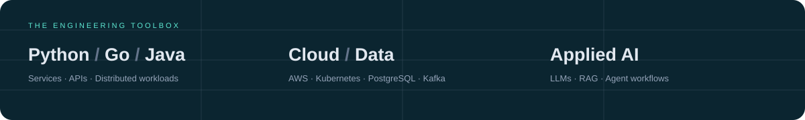

 

  

 

**I build the systems behind the product.**

Backend platforms · Event-driven systems · Data-intensive services · Production AI

 

<table>
<tr>
<td align="center" width="25%">

 
Dependency intelligence

</td>
<td align="center" width="25%">

 
Agent recovery CLI

</td>
<td align="center" width="25%">

 
Go file watcher

</td>
<td align="center" width="25%">

 
Multi-agent workspace

</td>
</tr>
</table>

Currently interested in systems design, developer infrastructure, and practical applications of LLMs.

  

<a href="https://ayushdoesdev.in">Explore the portfolio ↗</a>

