 

**I build the systems behind the product.**

Backend platforms · Event-driven systems · Data-intensive services · Production AI

 

### 🛠️ Technical Skills

- 💻 **Languages:** Python · SQL · Go
- ⚙️ **Backend:** FastAPI · Django · Flask · Kafka · gRPC · Gin
- ☁️ **Cloud:** AWS (EC2 · ECS · Lambda · S3 · SQS · API Gateway · RDS)
- 🗄️ **Databases:** PostgreSQL · Redis · MongoDB
- 🚀 **DevOps:** Git · GitHub · Jenkins · Docker · Kubernetes · Terraform
- 🤖 **GenAI:** LangChain · Azure OpenAI · Pinecone
- 🛠️ **Tools:** Prometheus · Grafana · Splunk · Jira · GitHub Copilot

### 🚀 Tech Stack

 

Focused on scalable backend platforms, reliable distributed systems, cloud infrastructure, and practical AI engineering.

  

<a href="https://ayushdoesdev.in">Explore the portfolio ↗</a>

